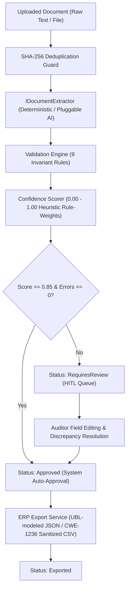

# DocumentOps — Automated Invoice Ingestion & Verification Engine

> **Enterprise-grade document processing pipeline built with .NET 8 Clean Architecture, featuring deterministic regex extraction, an extensible document intelligence pipeline, cross-field arithmetic validation, and a Human-in-the-Loop (HITL) review queue for automated ERP ingestion.**

[](https://dotnet.microsoft.com/)
[-success)](https://github.com/RASHA2702/DocumentOps)
[](LICENSE)
[](docs/ARCHITECTURE.md)
[](Dockerfile)

---

## 1. The Commercial Problem

Small and mid-sized enterprises (agencies, logistics firms, retail distributors, accounting practices) spend hundreds of hours manually keying vendor invoices and receipts into accounting software like QuickBooks, Xero, and SAP.

While modern OCR and vision models can extract raw text, commercial operations face three critical risks:
1. **Extraction & Arithmetic Errors**: Unvalidated models regularly misread line items or miscalculate sales taxes, corrupting accounting ledgers.
2. **Vendor Rate Limits & Cost**: Sending thousands of repetitive invoices to external cloud APIs introduces latency, recurring fees, and API downtime.
3. **Lack of Human Oversight**: Without a robust Human-in-the-Loop (HITL) review mechanism with blocking guards, error-ridden invoices get posted directly into financial ledgers.

**DocumentOps** provides a self-hosted solution that combines **instant offline deterministic extraction**, **cross-field arithmetic validation**, **rule-weighted confidence scoring**, and an **auditable human review workflow** before producing standard ERP export payloads.

---

## 2. System Architecture



### Clean Architecture Solution Layout
- **`DocumentOps.Core`**: Pure domain entities (`DocumentRecord`, `InvoiceData`, `InvoiceLineItem`, `ValidationDiscrepancy`, `DocumentAuditLog`) and status enums. Zero external dependencies.
- **`DocumentOps.Application`**: Use cases, validation engine (`IValidationEngine`), confidence scoring (`IConfidenceScorer`), and orchestrators (`DocumentProcessingService`, `DocumentReviewService`).
- **`DocumentOps.Infrastructure`**: Deterministic rule extractor (`RegexDocumentExtractor`), pluggable AI adapter (`MockAiDocumentExtractor`), thread-safe repository (`InMemoryDocumentRepository`), and ERP exporter (`ErpExportService`).
- **`DocumentOps.Api`**: ASP.NET Core minimal Web API with RFC 9457 `ProblemDetails` error handling and health probes.
- **`DocumentOps.Tests`**: 29 automated tests covering extraction accuracy, arithmetic auditing, currency subunit precision, line item duplicate detection, scoring penalties, approval guards, and CSV formula injection defense.

---

## 3. Key Capabilities

### 🔍 Deterministic & Extensible Extraction Pipeline
- **Sub-Millisecond Regex Parser**: Extracts vendor name, invoice number, issue/due dates, tax ID, currency, subtotal, tax amount, and multi-line item tables 100% offline.
- **Extensible Pipeline Interface**: Standardized `IDocumentExtractor` contract allows drop-in integration with document intelligence APIs and vision models, with automatic fallback to deterministic parsing upon rate limiting or network downtime.

### 🛡️ Cross-Field Arithmetic & Currency Invariant Engine
The validation engine continuously audits financial documents for arithmetic, currency precision, and temporal consistency across 9 invariant rules:
- **Cross-field reconciliation**: Enforces `|(Subtotal + Tax) - Total| <= 0.01`. Any discrepancy triggers a blocking `INV_ARITHMETIC_MISMATCH` error.
- **Line item summation**: Verifies that the sum of line items equals the reported subtotal.
- **Currency Subunit Precision (ISO 4217)**: Flags `INV_CURRENCY_PRECISION_MISMATCH` if amounts contain fractional cents in zero-decimal currencies (JPY, KRW, VND) or exceed standard currency decimal limits.
- **Line Item Detail & Duplicate Detection**: Enforces positive quantities, non-negative unit prices, line item calculation accuracy, and flags potential duplicate line items (`INV_DUPLICATE_LINE_ITEM`).
- **Temporal verification**: Detects date anomalies such as `DueDate < IssueDate` or suspicious future/historical dates.
- **Duplicate prevention**: Flags duplicate invoice numbers from identical vendors (`INV_DUPLICATE_NUMBER`) and avoids duplicate processing via SHA-256 document hashing.

### ⚖️ Weighted Confidence Scoring
- Calculates a transparent composite confidence score $C \in [0.0, 1.0]$ based on deterministic rule weights ($+0.20$ for invoice #, $+0.20$ for vendor, $+0.15$ for arithmetic reconciliation, $+0.10$ for line item match) minus penalties for discrepancies ($-0.35$ for errors, $-0.10$ for warnings).
- **Auto-Approval**: Documents with $C \ge 0.85$ and 0 errors bypass manual queues. Flawed documents are safely routed to the human review queue.

### 👥 Human-in-the-Loop (HITL) Review Queue
- Reviewers inspect flagged discrepancies with clear expected vs. actual values.
- Reviewers can update extracted fields and resolve discrepancy flags.
- **Strict Approval Guards**: The system prohibits approval if any unresolved blocking `Error` exists.

### 📤 Multi-Format ERP Export & Security
- **UBL-Modeled JSON**: Structured accounting schema modeled on UBL 2.1 invoice conventions for automated ingestion by enterprise accounting APIs.
- **Sanitized General Ledger CSV (CWE-1236 Defense)**: Formatted tabular CSV including header metadata and itemized transaction rows, protected against spreadsheet formula execution (`=`, `+`, `-`, `@`, tab, CR prefix neutralization).

---

## 4. API Endpoints Reference

| Method | Endpoint | Description |
| :--- | :--- | :--- |
| `GET` | `/health` | Service health check and operational status probe. |
| `GET` | `/api/dashboard/metrics` | High-level KPIs: Auto-approval rate, review backlog, total approved spend. |
| `GET` | `/api/documents` | Paginated document listing with filtering by `status` and `search`. |
| `GET` | `/api/documents/{id}` | Full document detail with extracted fields, line items, and discrepancies. |
| `POST` | `/api/documents/upload` | Upload raw document text or file for automated processing. |
| `PUT` | `/api/documents/{id}/review` | Human review update endpoint to modify fields and resolve flags. |
| `POST` | `/api/documents/{id}/approve` | Mark document as approved for ERP export (blocked if errors exist). |
| `POST` | `/api/documents/{id}/reject` | Reject invalid document with recorded reason. |
| `GET` | `/api/documents/{id}/export` | Export approved invoice in `format=json` (UBL-modeled) or `format=csv`. |

---

## 5. Quickstart & Local Execution

### Prerequisites
- [.NET 8 SDK](https://dotnet.microsoft.com/download/dotnet/8.0) or higher.
- [Docker](https://www.docker.com/) (optional, for containerized execution).

### Option A: Run with .NET CLI
```powershell
# Clone the repository
git clone https://github.com/RASHA2702/DocumentOps.git
cd DocumentOps

# Run the automated test suite
dotnet test tests/DocumentOps.Tests/DocumentOps.Tests.csproj

# Run the API server
dotnet run --project src/DocumentOps.Api/DocumentOps.Api.csproj
```
The server will start at `http://localhost:5080`.

### Option B: Run with Docker Compose
```bash
docker compose up -d --build
```

---

## 6. Live API Verification (Sample Curl Commands)

### 1. Ingest an Invoice via API
```bash
curl -X POST http://localhost:5080/api/documents/upload \
  -H "Content-Type: application/json" \
  -d '{
    "fileName": "acme-cloud.txt",
    "rawText": "Acme Cloud Services\nINVOICE\nInvoice #: INV-9901\nDate: 2026-10-01\nDue Date: 2026-10-31\n\nKubernetes Cluster 1 $1,000.00 $1,000.00\n\nSubtotal: $1,000.00\nTax: $100.00\nTotal: $1,100.00"
  }'
```

### 2. Check Dashboard Metrics
```bash
curl http://localhost:5080/api/dashboard/metrics
```
**Response:**
```json
{
  "totalDocuments": 3,
  "requiresReviewCount": 2,
  "approvedCount": 1,
  "exportedCount": 0,
  "rejectedCount": 0,
  "autoApprovalRatePercent": 33.3,
  "averageConfidencePercent": 79.3,
  "totalApprovedSpend": 1440.00
}
```

### 3. Export an Approved Document to Accounting JSON
```bash
curl "http://localhost:5080/api/documents/11111111-1111-1111-1111-111111111111/export?format=json"
```

---

## 7. Automated Test Suite

```powershell
dotnet test tests/DocumentOps.Tests/DocumentOps.Tests.csproj
```

**Results:**
```text
Test run for DocumentOps.Tests.dll (.NETCoreApp,Version=v8.0)
Passed!  - Failed: 0, Passed: 29, Skipped: 0, Total: 29, Duration: 596 ms
```

### Test Coverage Highlights
- Standard US & European currency and date format parsing.
- Fallback subtotal calculation from parsed line items.
- Arithmetic discrepancy detection (`INV_ARITHMETIC_MISMATCH`).
- Currency subunit precision validation (`INV_CURRENCY_PRECISION_MISMATCH`).
- Line item quantity, negative price, and duplicate description detection (`INV_DUPLICATE_LINE_ITEM`).
- Temporal inversion detection (`INV_DUE_BEFORE_ISSUE`).
- SHA-256 duplicate document detection.
- Approval barrier blocking unverified error states.
- UBL-modeled JSON and sanitized CSV export formatting with CWE-1236 formula defense.

---

## 8. Author & Contact

Built by **Rashad** — Full-Stack .NET & Angular Software Engineer
- **GitHub**: [@RASHA2702](https://github.com/RASHA2702)
- **Email**: [rashadhaq7@gmail.com](mailto:rashadhaq7@gmail.com)
- **Available for**: Remote contracts, system architecture consulting, and custom ERP integration development.
