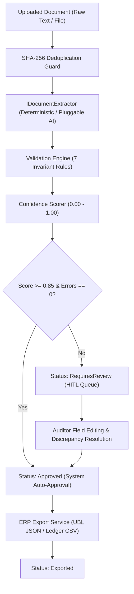

# DocumentOps — AI-Assisted Document & Invoice Ingestion Engine

> **Enterprise-grade document processing pipeline built with .NET 8 Clean Architecture, featuring deterministic regex extraction, an extensible AI/LLM structured schema pipeline, cross-field arithmetic validation, and a Human-in-the-Loop (HITL) review queue for automated ERP ingestion.**

[](https://dotnet.microsoft.com/)
[-success)](https://github.com/RASHA2702/DocumentOps)
[](LICENSE)
[](docs/ARCHITECTURE.md)
[](Dockerfile)

---

## 1. The Commercial Problem

Small and mid-sized enterprises (agencies, logistics firms, retail distributors, accounting practices) spend hundreds of hours manually keying vendor invoices and receipts into accounting software like QuickBooks, Xero, and SAP.

While modern AI and OCR models can extract raw text, commercial operations face three critical risks:
1. **Hallucination & Math Errors**: Raw LLM responses regularly hallucinate line totals or miscalculate sales taxes, corrupting accounting ledgers.
2. **Vendor Rate Limits & Cost**: Sending thousands of repetitive invoices to external APIs introduces latency, token costs, and API downtime.
3. **Lack of Human Oversight**: Without a robust Human-in-the-Loop (HITL) review mechanism with blocking guards, error-ridden invoices get posted directly into financial ledgers.

**DocumentOps** provides a battle-tested, self-hosted solution that combines **instant offline deterministic extraction**, **cross-field arithmetic validation**, **weighted confidence scoring**, and an **auditable human review workflow** before producing standard ERP export payloads.

---

## 2. System Architecture



### Clean Architecture Solution Layout
- **`DocumentOps.Core`**: Pure domain entities (`DocumentRecord`, `InvoiceData`, `InvoiceLineItem`, `ValidationDiscrepancy`, `DocumentAuditLog`) and status enums. Zero external dependencies.
- **`DocumentOps.Application`**: Use cases, validation engine (`IValidationEngine`), confidence scoring (`IConfidenceScorer`), and orchestrators (`DocumentProcessingService`, `DocumentReviewService`).
- **`DocumentOps.Infrastructure`**: Deterministic rule extractor (`RegexDocumentExtractor`), pluggable AI adapter (`MockAiDocumentExtractor`), thread-safe repository (`InMemoryDocumentRepository`), and ERP exporter (`ErpExportService`).
- **`DocumentOps.Api`**: ASP.NET Core minimal Web API with RFC 7807 `ProblemDetails` error handling and health probes.
- **`DocumentOps.Tests`**: 19 automated tests covering extraction accuracy, arithmetic auditing, scoring penalties, approval guards, and ERP formatting.

---

## 3. Key Capabilities

### 🔍 Deterministic & Extensible AI Pipeline
- **Sub-Millisecond Regex Parser**: Extracts vendor name, invoice number, issue/due dates, tax ID, currency, subtotal, tax amount, and multi-line item tables 100% offline.
- **Pluggable AI Interface**: `IDocumentExtractor` contract allows seamless integration with OpenAI (Structured Outputs), Claude 3.5, or Azure AI Document Intelligence with automatic fallback to deterministic parsing upon rate limiting or downtime.

### 🛡️ Cross-Field Arithmetic Invariant Engine
The validation engine continuously audits financial documents for arithmetic and temporal consistency:
- **Cross-field reconciliation**: Enforces `|(Subtotal + Tax) - Total| <= 0.01`. Any discrepancy triggers a blocking `INV_ARITHMETIC_MISMATCH` error.
- **Line item summation**: Verifies that the sum of line items equals the reported subtotal.
- **Temporal verification**: Detects date anomalies such as `DueDate < IssueDate` or suspicious future/historical dates.
- **Duplicate prevention**: Flags duplicate invoice numbers from identical vendors (`INV_DUPLICATE_NUMBER`) and avoids duplicate processing via SHA-256 document hashing.

### ⚖️ Weighted Confidence Scoring
- Dynamically calculates a confidence score $C \in [0.0, 1.0]$ based on field completeness signals ($+0.20$ for invoice #, $+0.20$ for vendor, $+0.15$ for arithmetic reconciliation) and deductions for discrepancies ($-0.35$ for errors, $-0.10$ for warnings).
- **Auto-Approval**: Documents with $C \ge 0.85$ and 0 errors bypass manual queues. Flawed documents are safely routed to the human review queue.

### 👥 Human-in-the-Loop (HITL) Review Queue
- Reviewers inspect flagged discrepancies with clear expected vs. actual values.
- Reviewers can update extracted fields and resolve discrepancy flags.
- **Strict Approval Guards**: The system prohibits approval if any unresolved blocking `Error` exists.

### 📤 Multi-Format ERP Export
- **UBL 2.1 JSON**: Standardized enterprise JSON schema ready for automated ingestion by QuickBooks, Xero, or custom enterprise APIs.
- **General Ledger CSV**: Formatted tabular CSV including header metadata and itemized transaction rows.

---

## 4. API Endpoints Reference

| Method | Endpoint | Description |
| :--- | :--- | :--- |
| `GET` | `/health` | Service health check and operational status probe. |
| `GET` | `/api/dashboard/metrics` | High-level KPIs: Auto-approval rate, review backlog, total approved spend. |
| `GET` | `/api/documents` | Paginated document listing with filtering by `status` and `search`. |
| `GET` | `/api/documents/{id}` | Full document detail with extracted fields, line items, and discrepancies. |
| `POST` | `/api/documents/upload` | Upload raw document text or file for automated processing. |
| `PUT` | `/api/documents/{id}/review` | Human review update endpoint to modify fields and resolve flags. |
| `POST` | `/api/documents/{id}/approve` | Mark document as approved for ERP export (blocked if errors exist). |
| `POST` | `/api/documents/{id}/reject` | Reject invalid document with recorded reason. |
| `GET` | `/api/documents/{id}/export` | Export approved invoice in `format=json` (UBL) or `format=csv`. |

---

## 5. Quickstart & Local Execution

### Prerequisites
- [.NET 8 SDK](https://dotnet.microsoft.com/download/dotnet/8.0) or higher.
- [Docker](https://www.docker.com/) (optional, for containerized execution).

### Option A: Run with .NET CLI
```powershell
# Clone the repository
git clone https://github.com/RASHA2702/DocumentOps.git
cd DocumentOps

# Run the automated test suite
dotnet test tests/DocumentOps.Tests/DocumentOps.Tests.csproj

# Run the API server
dotnet run --project src/DocumentOps.Api/DocumentOps.Api.csproj
```
The server will start at `http://localhost:5080`.

### Option B: Run with Docker Compose
```bash
docker compose up -d --build
```

---

## 6. Live API Verification (Sample Curl Commands)

### 1. Ingest an Invoice via API
```bash
curl -X POST http://localhost:5080/api/documents/upload \
  -H "Content-Type: application/json" \
  -d '{
    "fileName": "acme-cloud.txt",
    "rawText": "Acme Cloud Services\nINVOICE\nInvoice #: INV-9901\nDate: 2026-10-01\nDue Date: 2026-10-31\n\nKubernetes Cluster 1 $1,000.00 $1,000.00\n\nSubtotal: $1,000.00\nTax: $100.00\nTotal: $1,100.00"
  }'
```

### 2. Check Dashboard Metrics
```bash
curl http://localhost:5080/api/dashboard/metrics
```
**Response:**
```json
{
  "totalDocuments": 3,
  "requiresReviewCount": 2,
  "approvedCount": 1,
  "exportedCount": 0,
  "rejectedCount": 0,
  "autoApprovalRatePercent": 33.3,
  "averageConfidencePercent": 79.3,
  "totalApprovedSpend": 1440.00
}
```

### 3. Export an Approved Document to Accounting JSON
```bash
curl "http://localhost:5080/api/documents/11111111-1111-1111-1111-111111111111/export?format=json"
```

---

## 7. Automated Test Suite

```powershell
dotnet test tests/DocumentOps.Tests/DocumentOps.Tests.csproj
```

**Results:**
```
Test run for DocumentOps.Tests.dll (.NETCoreApp,Version=v8.0)
Passed!  - Failed:     0, Passed:    19, Skipped:     0, Total:    19, Duration: 875 ms
```

### Test Coverage Highlights
- ✅ Standard US & European currency and date format parsing.
- ✅ Fallback subtotal calculation from parsed line items.
- ✅ Arithmetic discrepancy detection (`INV_ARITHMETIC_MISMATCH`).
- ✅ Temporal inversion detection (`INV_DUE_BEFORE_ISSUE`).
- ✅ SHA-256 duplicate document detection.
- ✅ Approval barrier blocking unverified error states.
- ✅ Full UBL 2.1 JSON and CSV general ledger export formatting.

---

## 8. Freelance & Contract Inquiries

This system was designed and implemented by a full-stack .NET & cloud engineer specializing in business automation, accounts payable integration, and AI document processing for clients across the US, UK, EU, Australia, and Canada.

- **GitHub Profile**: [@RASHA2702](https://github.com/RASHA2702)
- **Primary Expertise**: C#, ASP.NET Core, Clean Architecture, Angular, TypeScript, SQL Server, Background Workers, API Integration, and Resilient Cloud Architecture.

For freelance contracts, architecture consultations, or custom ERP integration development, reach out via GitHub.
