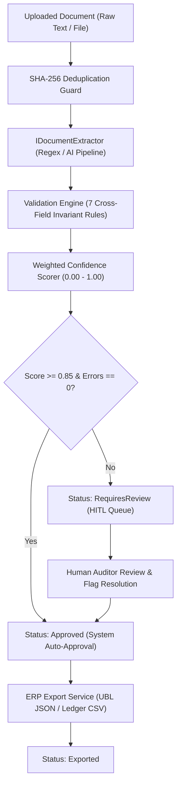
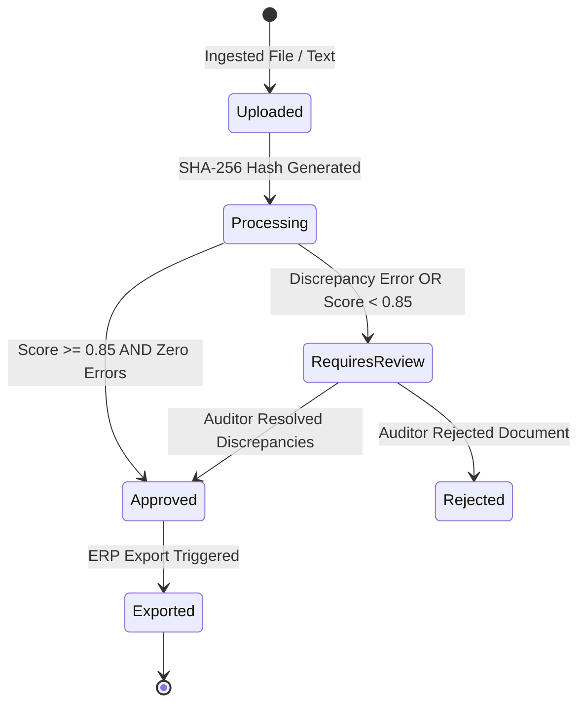

# DocumentOps — Architecture & System Design

## 1. Executive Summary

`DocumentOps` is an enterprise document ingestion and automated accounts payable (AP) pipeline built on **.NET 8 Clean Architecture**. It solves the critical operational challenge of processing hundreds of vendor invoices, freight bills, and receipts by combining **deterministic heuristic extraction**, an **extensible AI/LLM structured schema pipeline**, a **cross-field arithmetic validation engine**, and a **Human-in-the-Loop (HITL) review queue**.



---

## 2. Clean Architecture Layering

The codebase is strictly separated into four decoupled layers following Domain-Driven Design (DDD) principles:

```
c:\Projects\DocumentOps\
├── src\
│   ├── DocumentOps.Core\            # Pure domain models, entities, and enums (Zero dependencies)
│   ├── DocumentOps.Application\     # Business logic, interfaces, validators, and orchestration services
│   ├── DocumentOps.Infrastructure\  # Regex extractor, AI adapters, thread-safe persistence, and ERP exporters
│   └── DocumentOps.Api\             # ASP.NET Core Minimal Web API, RFC 7807 problem details, and middleware
└── tests\
    └── DocumentOps.Tests\           # Unit and integration test suite (MSTest, Moq)
```

### Layer Responsibilities

1. **`DocumentOps.Core`**:
   - Zero external dependencies.
   - Core domain aggregates: `DocumentRecord`, `InvoiceData`, `InvoiceLineItem`, `ValidationDiscrepancy`, and `DocumentAuditLog`.
   - Domain enums: `DocumentStatus` (`Uploaded`, `Processing`, `Extracted`, `RequiresReview`, `Approved`, `Rejected`, `Exported`) and `DiscrepancySeverity` (`Info`, `Warning`, `Error`).

2. **`DocumentOps.Application`**:
   - Repository interfaces (`IDocumentRepository`), extraction strategies (`IDocumentExtractor`), arithmetic validation contracts (`IValidationEngine`), and scoring rules (`IConfidenceScorer`).
   - Use-case services:
     - `DocumentProcessingService`: Orchestrates upload -> deduplication -> extraction -> validation -> confidence scoring -> routing.
     - `DocumentReviewService`: Manages human edits, discrepancy resolutions, approval guards, and KPI aggregation.

3. **`DocumentOps.Infrastructure`**:
   - `RegexDocumentExtractor`: High-precision deterministic parser for offline invoice processing.
   - `MockAiDocumentExtractor`: Demonstrates pluggable integration with OpenAI / Claude / Azure AI Document Intelligence.
   - `InMemoryDocumentRepository`: Thread-safe concurrent storage pre-seeded with realistic enterprise invoice edge cases.
   - `ErpExportService`: Serializes approved invoices into UBL 2.1-compliant JSON and general-ledger accounting CSVs.

4. **`DocumentOps.Api`**:
   - ASP.NET Core minimal endpoints.
   - RFC 7807 `ProblemDetails` exception handling.
   - CORS policy configuration and health check probes.

---

## 3. Lifecycle State Machine



### Guard Conditions
- **Approval Guard**: A document *cannot* transition to `Approved` while any `Error`-level discrepancy remains unresolved.
- **Export Guard**: Only documents in `Approved` state may be exported to ERP integrations.
- **Immutability Guard**: Once a document reaches `Exported` status, field modifications and rejections are strictly prohibited to prevent accounting ledger desynchronization.

---

## 4. Deduplication & Audit Integrity

1. **SHA-256 File Hash**: Every document body is hashed upon upload. If a file with an identical hash is submitted, the system returns the existing document record and appends a `DuplicateUploadIgnored` audit entry rather than creating orphaned entries.
2. **Duplicate Invoice Number Detection**: The pipeline searches the repository for existing records matching `VendorName` + `InvoiceNumber`. If detected, an `INV_DUPLICATE_NUMBER` error flag is appended to protect against double payments.
3. **Comprehensive Audit Trail**: Every status change, regex signal match, human override, and export event is immutably timestamped in `DocumentAuditLog`.
